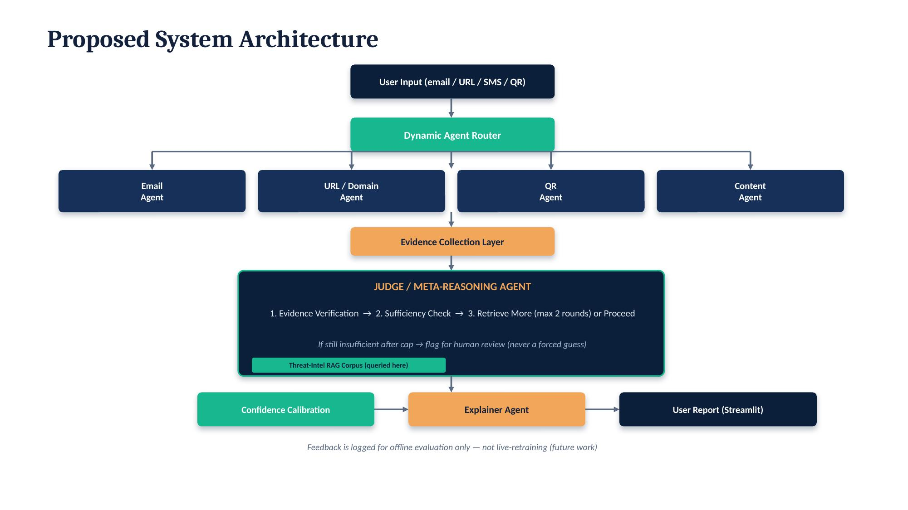

# Architecture

## Flow

1. **User Input** — email, URL, SMS, or QR-code content is submitted.
2. **Dynamic Agent Router** (`src/agents/router.py`) — detects input type and
   decides which evidence agents actually need to run. A plain SMS never
   triggers the QR agent; a bare URL never triggers the email agent.
3. **Evidence Agents** — each gathers domain-specific signals:
   - `email_agent.py` — header/display-name mismatch heuristics
   - `url_agent.py` — WHOIS domain age, Google Safe Browsing, VirusTotal
   - `qr_agent.py` — decodes the QR payload and hands it to the URL agent
   - `content_agent.py` — LLM-based urgency/credential-request/impersonation detection
4. **Judge / Meta-Reasoning Agent** (`src/agents/judge_agent.py`) — the core
   architectural contribution. It is a **single, non-redundant process** that
   owns two responsibilities (deliberately not split into separate agents —
   see the design rationale below):
   - **Evidence Verification** — checks whether collected signals agree or
     conflict, and surfaces the conflict explicitly rather than silently
     averaging it away.
   - **Sufficiency Check** — decides whether there's enough evidence to
     commit to a verdict. If not, it triggers **sufficiency-gated retrieval**
     against the RAG corpus (grounded in Self-RAG / Corrective RAG), capped
     at `MAX_RETRIEVAL_ROUNDS` (default 2). If still insufficient after the
     cap, the Judge returns `NEEDS_HUMAN_REVIEW` rather than forcing a
     low-confidence guess.
5. **Confidence Calibration** (`src/agents/calibration.py`) — a logistic
   regression model trained on evidence-derived features, turning raw signals
   into a calibrated confidence score. This is the one component in the
   system that is actually *trained* — the LLM agents only prompt and retrieve.
6. **Explainer Agent** (`src/agents/explainer_agent.py`) — converts the
   verdict and evidence into a plain-language, action-oriented explanation
   for a non-technical reader. This is the project's central contribution:
   no prior reviewed system evaluates whether this step's output is actually
   comprehended.

## Design rationale: why Judge owns both verification and sufficiency-gating

An earlier design considered these as two separate agents/components. They
were deliberately merged into one because having two independent components
both deciding "is this enough evidence" creates ambiguity about which one's
decision governs, and is a real architectural weak point a reviewer would
flag. The Judge is the single authority on sufficiency; "Active RAG
retrieval" is a **capability it invokes**, not an independent agent with its
own opinion.

## Explicit scope boundaries (not implemented, and why)

- **Live self-updating knowledge base** — feedback from users is logged for
  offline evaluation only, never fed back into the live RAG corpus during
  evaluation. A continuously-updating corpus breaks reproducibility (results
  can't be verified against a fixed dataset) and introduces a
  memory-poisoning attack surface, documented in the Agent Security Bench
  (ASB) literature. Scoped as future work.
- **Native mobile SMS/call interception** — requires OS-level permissions
  (Android's default-SMS-handler restriction, iOS's lack of any such API),
  raises consent/legal questions, and is a substantially larger, separate
  engineering effort. The current system operates on user-forwarded content.
- **Malware/attachment analysis** — a natural extension (many phishing
  attacks deliver malware payloads), but requires a different data domain
  (binary/file-structure features) and its own datasets; noted as future
  work, not attempted here.
- **Multilingual (Hindi/Telugu) explanation output** — a real gap given the
  target population; the Explainer Agent's prompt can be extended to
  generate in a requested language, but this needs separate evaluation
  (comprehension testing per language) before being claimed as complete.
